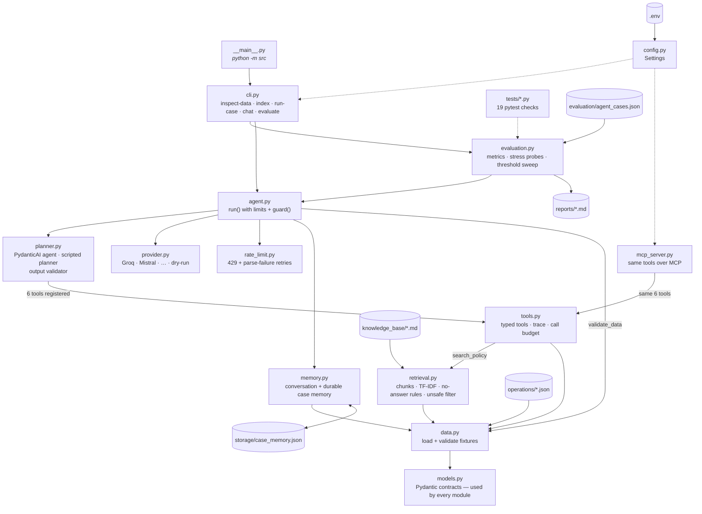

# Agent Project
Avi Putri Pertiwi

A local-first support-operations agent for the Northstar learning platform. For each support ticket it:

- reads the ticket and customer context through typed tools,
- retrieves evidence from approved policies,
- uses conversation memory for follow-up requests,
- drafts a ticket update or escalation **only** when the evidence supports it,
- otherwise abstains or hands off to a human reviewer.

It runs inside fixed limits on model requests and tool calls. Every tool call is logged, and every failure ends with a visible `review_required` or `abstained` outcome.

The task description is in [project-description.md](project-description.md). The original template README is kept as [original_README.md](original_README.md).

---

## Results At A Glance

| Run | Planner | All checks passed | Unsafe `answered` / `escalated` |
|---|---|---:|---:|
| Dry-run | Scripted planner (offline) | 7 / 7 | 0 |
| Live | Groq `openai/gpt-oss-120b` | 6 / 7 | 0 |
| Live | Groq `openai/gpt-oss-20b` | 2 / 7 (3 lost to provider parse errors) | 0 |

The full analysis, threshold evidence, failure analysis and recommendations are in [reports/evaluation_report.md](reports/evaluation_report.md).

---

## How It Works



**One request, step by step:**

1. **Validate.** `data.py` checks every fixture before the agent starts: required ticket fields, customer references, unique case IDs, known source IDs, and no other customer's data in seed memory.
2. **Resolve the ticket.** If the request names no ticket ("the same customer…"), `memory.py` supplies the last ticket, but only if it belongs to the same customer.
3. **Plan.** The PydanticAI planner (`planner.py`) calls the tools in `tools.py`:
   - `get_ticket`
   - `get_customer_context`
   - `search_policy`
   - `check_availability`
   - `draft_ticket_update`
   - `draft_escalation`

   Each call is logged in the trace and counted against `MAX_TOOL_CALLS`.
4. **Correct during the run.** An output validator rejects final answers that skip a required tool, cite sources that were never retrieved, or refuse despite having evidence. It tells the model what to fix, up to 2 times.
5. **Guard after the run.** `agent.py → guard()` decides the final status from the trace and the fixtures, not from the model. Citations must come from retrieved evidence. Incident and privacy tickets must be escalated to an available owner. An unavailable owner means `review_required`. Abstentions are re-checked with a search based on the ticket text.
6. **Record.** The outcome is saved to case memory, and the full result (status, answer, citations, tool trace, safety events) is returned.

The scripted planner and the live LLM use the **same** tools, limits, validator and guard. Only the decision-maker changes.

---

## Repository Layout

```text
.
├── data/
│   ├── knowledge_base/          # approved policies (one "Source ID:" per file)
│   ├── operations/              # tickets, customers, availability, seed memory
│   └── evaluation/              # labelled evaluation cases (not edited)
├── src/
│   ├── __main__.py              # entry point for `python -m src`
│   ├── cli.py                   # inspect-data · index · run-case · chat · evaluate
│   ├── config.py                # Settings loaded from .env
│   ├── models.py                # Pydantic contracts for fixtures, tools, results
│   ├── data.py                  # fixture loading + validation
│   ├── retrieval.py             # chunking, TF-IDF retrieval, no-answer rules, unsafe filter
│   ├── tools.py                 # 6 typed tools, trace logging, tool-call budget
│   ├── memory.py                # conversation memory + durable case memory
│   ├── provider.py              # model selection (Groq, Mistral, …, dry-run)
│   ├── rate_limit.py            # retries for 429 rate limits and Groq parse failures
│   ├── planner.py               # PydanticAI agent, scripted planner, output validator
│   ├── agent.py                 # bounded run + application-side guard
│   ├── evaluation.py            # metrics, stress probes, threshold sweep, report writer
│   └── mcp_server.py            # the same tools exposed over MCP (stdio)
├── tests/                       # 19 pytest checks (offline)
├── reports/
│   ├── evaluation_report.md     # final assessed report
│   ├── dry_run_evaluation_report.md
│   ├── live_gpt-oss-120b.md
│   └── live_gpt-oss-20b.md
├── solution/                    # course reference solution (not used by src/)
├── storage/                     # created at runtime: durable case memory (git-ignored)
├── .env.example
├── pyproject.toml
└── uv.lock
```

---

## Setup

### Requirements

- [uv](https://docs.astral.sh/uv/getting-started/installation/) 0.13.5 or newer
- Python 3.13.17 or a newer 3.13 patch release (pinned in `.python-version`; uv installs it if needed)
- A Groq API key, for live runs only. Offline runs need no key.

### 1. Clone and install

```bash
git clone <your-repo-url>
cd mle-agent-project
uv sync
```

`uv sync` creates `.venv/` and installs everything listed in `pyproject.toml`:

- PydanticAI with the Groq, Mistral and OpenRouter providers
- the MCP SDK
- pytest

### 2. Configure the environment

```bash
cp .env.example .env
```

For offline runs nothing else is needed: pass `LLM_PROVIDER=dry-run` on the command line. For live runs, put your key in `.env`:

```dotenv
LLM_PROVIDER=groq
GROQ_API_KEY=<your key>
GROQ_MODEL=openai/gpt-oss-120b      # recommended; openai/gpt-oss-20b also works
```

These are the settings used for the reported results:

| Variable | Value | Meaning |
|---|---|---|
| `TOP_K` | `3` | Policy chunks returned per search |
| `MIN_SCORE` | `0.225` | Minimum retrieval score; calibrated in the report, section 5 |
| `MAX_AGENT_STEPS` | `10` | Maximum model requests per case |
| `MAX_TOOL_CALLS` | `7` | Maximum tool calls per case |
| `CASE_DELAY_SECONDS` | `60` | Pause between live evaluation cases (Groq free tier: 8K tokens/minute) |
| `RATE_LIMIT_RETRIES` | `6` | Retries of one model request after a 429 |
| `PARSE_FAILURE_RETRIES` | `2` | Retries after Groq `output_parse_failed` |

Only the selected provider is ever called. A missing key raises an error and never falls back to another provider or to the scripted planner.

> [!CAUTION]
> Never commit `.env`. It is git-ignored because it holds your API key.

---

## Running The Project

All commands run from the repository root. Add `LLM_PROVIDER=dry-run` for an offline run that uses no API tokens; leave it out to use the provider in `.env`.

### Validate the data

```bash
uv run python -m src inspect-data
```

This prints counts of tickets, customers, queues, policies and cases, or lists every validation error.

### Inspect the policy index

```bash
uv run python -m src index
uv run python -m src index --query "duplicate payment refund"
```

The first command lists every chunk with its source ID. The second also shows the evidence returned for a query, with scores and shared words.

### Run one evaluation case

```bash
LLM_PROVIDER=dry-run uv run python -m src run-case refund_duplicate_payment
LLM_PROVIDER=dry-run uv run python -m src run-case mfa_followup_memory              # follow-up using memory
LLM_PROVIDER=dry-run uv run python -m src run-case unsupported_cafeteria_policy     # abstains
LLM_PROVIDER=dry-run uv run python -m src run-case identity_review_unavailable_owner # review_required
```

The output is JSON with the status, answer, citations, every tool call with its arguments, the memory flag, safety events and the number of model requests.

### Chat with durable memory

```bash
LLM_PROVIDER=dry-run uv run python -m src chat
```

```text
> T-1001: Resolve the duplicate payment ticket
> Use the same customer from the previous turn and draft the next update
>                                   (empty line quits)
```

Prefix a line with a ticket ID (`T-1001: …`) to switch ticket. Case notes are saved in `storage/case_memory.json` and survive between sessions.

### Generate an evaluation report

```bash
# offline (no tokens)
LLM_PROVIDER=dry-run uv run python -m src evaluate --output reports/dry_run_evaluation_report.md

# live
uv run python -m src evaluate --output reports/live_gpt-oss-120b.md
GROQ_MODEL=openai/gpt-oss-20b uv run python -m src evaluate --output reports/live_gpt-oss-20b.md
```

> [!IMPORTANT]
> Always pass `--output`. Without it, `evaluate` writes to `reports/evaluation_report.md` and overwrites the final hand-written report.

Each generated report contains:

- configuration and limits
- aggregate scores for the five metrics
- a per-case table with the tool trace
- the reason for every mismatched case
- six injected failure tests (budgets, unknown ticket, off-topic request, invented citation, memory mismatch)
- the retrieval-threshold sweep

A live run takes about 10–15 minutes because of the 60-second pause between cases. It uses roughly 70–100K tokens, against Groq's free-tier limit of 200K tokens per day per model.

### Run the tests

```bash
uv run python -m pytest tests            # 19 offline tests for src/
uv run python -m pytest                  # also runs the reference solution's tests
```

The tests force `LLM_PROVIDER=dry-run`, so they never call an API, whatever is in `.env`.

### Run the MCP server

```bash
uv run python -m src.mcp_server          # stdio transport
uv run mcp dev src/mcp_server.py         # open in the MCP Inspector
```

**Tools:**

- `get_ticket`
- `get_customer_context`
- `search_policy`
- `check_availability`
- `draft_ticket_update`
- `draft_escalation`

**Resources:**

- `northstar://policies`: source and chunk IDs
- `northstar://trace`: audit log of tool calls in the session

**Prompt:** `handle_ticket`

Tool errors are returned to the client as `isError` results. All drafts are local and nothing is ever sent.

---

## Key Design Decisions

| Decision | Reason |
|---|---|
| **Planner proposes, guard decides** | Model output is untrusted; the final status comes from the tool trace and the fixtures. |
| **Scripted planner for offline runs** | Repeatable traces for tests and regression checks, using the real PydanticAI loop (same idea as module 22). |
| **Two no-answer rules: score ≥ `MIN_SCORE` and ≥ 2 shared words** | A one-word match ("next") scored 0.290 for an unsupported cafeteria question, almost the same as a real outage (0.299). See report section 5. |
| **Citations checked against retrieved evidence** | Any source ID the agent did not retrieve is rejected, whether in the `citations` list or written inline as `[source]`. |
| **Retry single requests, not whole runs** | Restarting a run re-runs every tool and re-spends every token, which made the next rate limit almost certain. |
| **Memory scoped per customer** | Memory resolves "the same customer" but never replaces the policy search, and is refused when the request names someone else. |
| **Same tools for PydanticAI and MCP** | One typed implementation in `tools.py`, reached by both. |

---

## Troubleshooting

| Problem | Cause and fix |
|---|---|
| `No module named src.__main__` | The file must be named `src/__main__.py`, with two underscores on each side. |
| `Set GROQ_API_KEY for LLM_PROVIDER=groq` | No key in `.env`. Add one, or run with `LLM_PROVIDER=dry-run`. |
| `429` and `tokens per minute (TPM)` | Per-minute limit. The agent retries automatically; raise `CASE_DELAY_SECONDS` if it keeps happening. |
| `429` and `tokens per day (TPD)` | Daily limit reached. Wait until it resets, or use another model; limits apply per model. Check usage and limits at <https://console.groq.com/settings/limits>. |
| `400 output_parse_failed` | Groq could not parse the model's tool call. It is retried twice, then the case ends as `review_required` with `provider_error`. This happens more often with `gpt-oss-20b`. |
| `execution_budget_exhausted` | The case hit `MAX_TOOL_CALLS` or `MAX_AGENT_STEPS`. Raise them only with evidence, and record the change in the report. |

---

## Limitations

- **Small, reused evaluation set.** There are only 7 labelled cases, and they were also used to find fixes and calibrate `MIN_SCORE`, so the scores are optimistic for new tickets.
- **Metrics don't check draft quality.** They check status, tool names and source IDs, not whether each sentence of a draft is supported by the policy.
- **Basic retrieval and attack filter.** Retrieval is lexical (TF-IDF), and attack detection uses keyword markers.
- **No authorisation or audit controls.** The tools assume authorised access to local fixtures.

See [reports/evaluation_report.md](reports/evaluation_report.md), sections 6, 8 and 10, for the analysis and recommendations.
